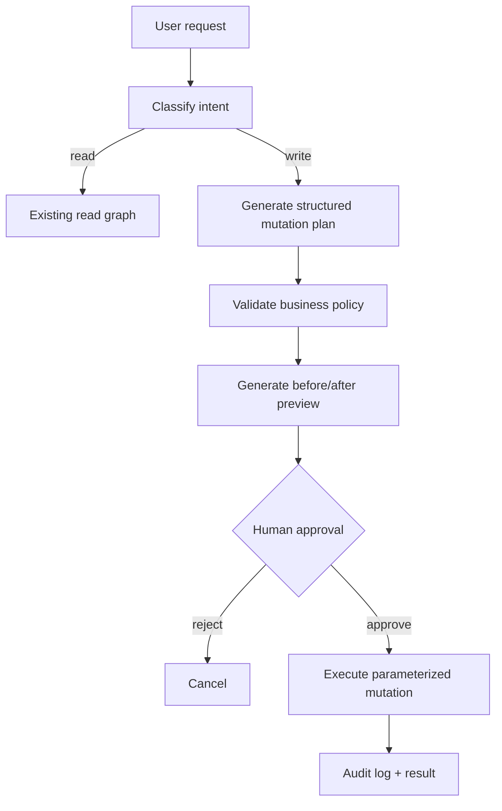

# Extending the agent to safe write operations

The shipped project is read-only. This is deliberate.

A production write agent should use a separate workflow rather than merely allowing `UPDATE` in `safety.py`.

## Proposed workflow



## Do not execute arbitrary LLM-written mutation SQL

Prefer a fixed tool such as:

```python
update_customer_status(customer_id: int, new_status: Literal["active", "inactive"])
```

The LLM chooses structured arguments. Your application generates parameterized SQL.

That is substantially safer than allowing a model to emit:

```sql
UPDATE ...
```

against a general write connection.

## Required controls

- separate database role for each mutation capability
- human approval for consequential changes
- idempotency key on every mutation request
- explicit transaction
- affected-row limit
- before/after preview
- immutable audit record
- authorization tied to the human user
- optimistic concurrency or version checking where appropriate
- rollback or compensating operation

## Example structured mutation

```json
{
  "operation": "update_customer_status",
  "arguments": {
    "customer_id": 123,
    "new_status": "inactive"
  },
  "reason": "Customer requested account deactivation"
}
```

The application can validate this against policy and translate it into parameterized SQL without exposing a general-purpose mutation tool.
